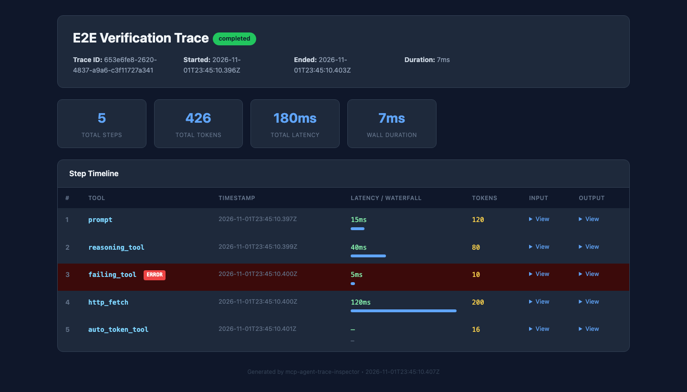
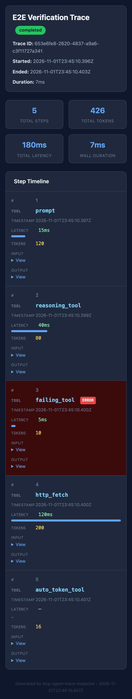
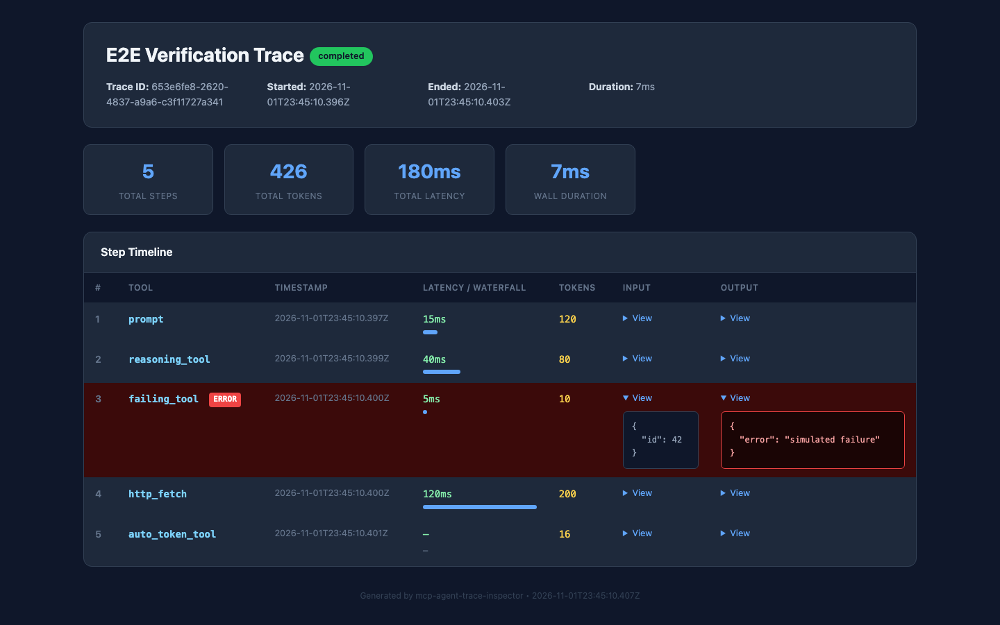

# MCP Agent Trace Inspector

Local-first, MCP-native observability for agent workflows. Every tool call, prompt
transformation, latency, token estimate, and cost estimate is recorded in a local
SQLite database — no cloud account, no API key, and no traces leaving your machine.

Built specifically for MCP rather than bolted onto a generic LLM proxy.

[Tools](#tools) · [Configuration](#configuration) · [HTTP transport](#streamable-http-transport) ·
[Verification](#verification) · [Known limitations](#known-limitations) · [Contributing](#contributing)

## Overview

`mcp-agent-trace-inspector` is an MCP server. Agents call its tools to start a trace,
record each step they take, and finish the trace. Humans then inspect summaries,
compare runs, export a self-contained HTML dashboard, export OTLP/JSON spans, or
stream the compliance audit log.

```text
Agent / MCP client
      │  trace_start → trace_step → trace_end
      ▼
MCP Agent Trace Inspector
      ├── SQLite (~/.mcp/traces.db)
      ├── JSONL audit log (~/.mcp/trace-inspector-audit.jsonl)
      └── tools: summaries, diffs, HTML, OTLP/JSON, retention, alerts
```

## Key features

- **Tool-call tracing** — inputs, outputs, latency, caller-supplied or automatic
  token estimates for every step.
- **Persistent local storage** — SQLite via Node's built-in `node:sqlite`; traces
  survive restarts and never require a service.
- **Self-contained HTML dashboard** — error highlighting, step timeline, latency
  waterfall, responsive layout, and expandable input/output JSON.
- **Cost estimation** — offline `cl100k_base` tokenizer plus a configurable pricing
  table; no API calls and no billing-account data.
- **Trace comparison** — aggregate and step-by-step diffs between two runs.
- **Reasoning-chain extraction** — finds reasoning/thinking/planning steps.
- **OTLP/JSON export** — standard `resourceSpans → scopeSpans → spans` documents.
- **Compliance audit log** — append-only JSONL of recorded steps, exportable as JSON
  or CSV with date filtering.
- **Alerts** — persisted latency, error-rate, and cost thresholds evaluated when a
  trace ends; optional Slack or generic webhook delivery.
- **Retention controls** — startup purge or explicit archive/delete policy.
- **Two transports** — stdio (default) and stateless Streamable HTTP with optional
  API-key/JWT authentication and rate limiting.

## Technology stack

| Layer            | Choice                                                        |
| ---------------- | ------------------------------------------------------------- |
| Runtime          | Node.js ≥ 22.13 (ESM, built-in `node:sqlite`)                 |
| Language         | TypeScript 5, strict mode                                     |
| Protocol         | `@modelcontextprotocol/sdk` (tools, resources, prompts)       |
| HTTP             | Express 5 + MCP Streamable HTTP transport                     |
| Storage          | SQLite through `node:sqlite`                                  |
| Tokenization     | `gpt-tokenizer` (`cl100k_base`)                               |
| CLI              | `yargs`                                                       |
| Tests            | Vitest + V8 coverage                                          |
| Lint / formatting| ESLint + Prettier                                             |
| CI               | GitHub Actions (install, audit, lint, format, test, build)    |

## Requirements

- **Node.js 22.13.0 or newer.** `node:sqlite` first became available in Node 22.5.0
  behind `--experimental-sqlite`; it is unflagged from 22.13.0. This project does not
  pass the flag.
- npm.
- No database server, API key, or external account is required for core tracing.

## Quick start (MCP client)

Add the server to your MCP client configuration:

```json
{
  "mcpServers": {
    "trace-inspector": {
      "command": "npx",
      "args": ["-y", "mcp-agent-trace-inspector@latest"]
    }
  }
}
```

Use a project-specific database:

```json
{
  "mcpServers": {
    "trace-inspector": {
      "command": "npx",
      "args": [
        "-y",
        "mcp-agent-trace-inspector@latest",
        "--db=~/traces/my-project.db"
      ]
    }
  }
}
```

Then ask your agent to trace its own work:

```text
Start a trace named "test-run" with trace_start.
Record a trace_step for each tool you call, including that tool's input and output.
Call trace_end when you are done, then call get_trace_summary for the trace.
```

The summary contains the step count, estimated token total, total recorded latency,
wall-clock duration, cost estimate, and reasoning-chain detection. Tracing is explicit:
the inspector records steps when the agent calls `trace_step`; it does not intercept
other MCP servers automatically.

### From source

```bash
npm ci
npm run build
node dist/index.js --db=~/.mcp/traces.db
```

Development mode runs TypeScript directly and logs MCP protocol messages on stderr:

```bash
npm run dev -- --db=/tmp/traces.db
```

## Streamable HTTP transport

HTTP mode is useful for a local team instance or a container. It is **stateless**:
every POST gets a fresh MCP server and transport, there is no `Mcp-Session-Id`, and the
endpoint does not offer a server-initiated SSE stream. Send every JSON-RPC message as
its own `POST /mcp` request.

```bash
node dist/index.js --db=~/.mcp/traces.db --http-port=3000 --http-host=127.0.0.1
# stderr: MCP Agent Trace Inspector HTTP server listening on http://127.0.0.1:3000/mcp
```

Initialize the endpoint:

```bash
curl -s http://127.0.0.1:3000/mcp \
  -H 'Content-Type: application/json' \
  -H 'Accept: application/json, text/event-stream' \
  -d '{"jsonrpc":"2.0","id":1,"method":"initialize","params":{"protocolVersion":"2025-06-18","capabilities":{},"clientInfo":{"name":"curl","version":"1"}}}'
```

The response is an SSE frame. Call a tool:

```bash
curl -s http://127.0.0.1:3000/mcp \
  -H 'Content-Type: application/json' \
  -H 'Accept: application/json, text/event-stream' \
  -d '{"jsonrpc":"2.0","id":2,"method":"tools/call","params":{"name":"list_traces","arguments":{}}}'
```

| Behavior              | Value                                                        |
| --------------------- | ------------------------------------------------------------ |
| Endpoint              | `POST /mcp`                                                  |
| `GET` / `DELETE /mcp` | `405` with `Allow: POST`                                     |
| Default bind address  | `127.0.0.1` (loopback only)                                  |
| Request body limit    | 10 MB                                                        |
| Rate limit            | 60 requests / 60 s per validated API key or client IP        |
| Auth (optional)       | `X-API-Key` and/or `Authorization: Bearer <HS256 JWT>`       |
| DNS-rebinding guard   | Host header must be localhost/127.0.0.1 when bound to loopback |

### HTTP authentication

Set one or both environment variables before starting the server:

```bash
MCP_API_KEY=change-me \
MCP_JWT_SECRET=change-me-too \
node dist/index.js --http-port=3000 --http-host=127.0.0.1
```

- If `MCP_API_KEY` is set, every HTTP request must send `X-API-Key: <value>`.
- If `MCP_JWT_SECRET` is set, every HTTP request must send
  `Authorization: Bearer <HS256 JWT>`; `exp` and `nbf` claims are checked.
- If both are set, both are required.
- The stdio transport ignores both variables.

`--http-host=0.0.0.0` is allowed but the server warns. Put TLS and an authenticating
reverse proxy in front of any non-loopback deployment; do not expose the raw endpoint
to an untrusted network.

When the server is bound to loopback behind a reverse proxy, the proxy must rewrite the
`Host` header to `127.0.0.1:<port>`. The loopback DNS-rebinding guard rejects other
`Host` values with `403` by design.

## Configuration

### CLI flags

| Flag                    | Default              | Description                                                                 |
| ----------------------- | -------------------- | --------------------------------------------------------------------------- |
| `--db`, `--db-path`     | `~/.mcp/traces.db`   | SQLite database file. `~` is expanded. `:memory:` is supported for tests.   |
| `--retention-days`      | `0`                  | On startup, delete traces older than N days. `0` disables.                  |
| `--pricing-table`       | built-in table       | JSON file of `{ "model": { "input": number, "output": number } }`. Merged over built-in rates. |
| `--no-token-count`      | `false`              | Disable automatic token counting (`token_count` values become `null`).      |
| `--http-port`           | unset                | Start in HTTP mode on this port (1–65535) instead of stdio.                 |
| `--http-host`           | `127.0.0.1`          | HTTP bind address. Prefer loopback unless authentication and TLS are used.  |
| `--help`                | —                    | Show usage.                                                                 |
| `--version`             | —                    | Print the package version.                                                  |

### Environment variables

The server does **not** load `.env` files automatically. Export variables in your
shell or configure them in your MCP client.

| Variable               | Default                                   | Purpose                                                                 |
| ---------------------- | ----------------------------------------- | ----------------------------------------------------------------------- |
| `MCP_API_KEY`          | unset                                     | HTTP only: require `X-API-Key` on every request.                        |
| `MCP_JWT_SECRET`       | unset                                     | HTTP only: require a valid HS256 Bearer JWT.                            |
| `MCP_AUDIT_LOG_PATH`   | `~/.mcp/trace-inspector-audit.jsonl`      | Compliance audit log path. Created owner-readable/writable (`0600`).    |
| `MCP_SLACK_WEBHOOK`    | unset                                     | Slack incoming-webhook URL used when an alert fires.                    |
| `MCP_ALERT_WEBHOOK`    | unset                                     | Generic JSON webhook URL used when an alert fires.                      |

See [`.env.example`](.env.example) for a copy-paste template. Never commit real
secrets or database files; both are ignored by `.gitignore`.

## Tools

The server exposes 13 tools. Tool annotations mark state-changing tools
(`readOnlyHint: false`) and destructive retention (`destructiveHint: true`).

### Trace lifecycle

| Tool          | Purpose                                                                                          |
| ------------- | ------------------------------------------------------------------------------------------------ |
| `trace_start` | Begin a trace. Returns a `trace_id`. Pass `"auto"` or an empty string for a generated name.        |
| `trace_step`  | Record one step for a **running** trace. Steps are rejected after `trace_end`.                    |
| `trace_end`   | Mark a trace completed, evaluate alert rules, and return fired alerts. Repeated calls are idempotent. |

`trace_step` requires `trace_id`, `tool_name`, `input` (object), and `output` (object).
`token_count` must be a non-negative integer; `latency_ms` must be a finite,
non-negative number. Caller-supplied token counts are used as-is.

### Inspection

| Tool                      | Purpose                                                                 |
| ------------------------- | ----------------------------------------------------------------------- |
| `list_traces`             | List traces, newest first. Optional positive-integer `limit`.            |
| `get_trace_summary`       | Step/token/latency totals, duration, cost estimate, reasoning detection. |
| `compare_traces`          | Diff two traces: aggregates, tool coverage, and per-position steps.     |
| `extract_reasoning_chain` | Return only reasoning/thinking/planning steps.                          |

### Export

| Tool                   | Purpose                                                                                          |
| ---------------------- | ------------------------------------------------------------------------------------------------ |
| `export_dashboard`     | Self-contained HTML dashboard with error rows, expandable JSON, and latency waterfall.           |
| `export_otel`          | OTLP/JSON document (`resourceSpans → scopeSpans → spans`) for one trace or all traces.            |
| `export_compliance_log`| Audit log as JSON or CSV, optionally filtered by `from_date` / `to_date` (date-only upper bound includes the whole day). |

`export_otel` returns a document; it does **not** push to a collector. Write the
result to a file and submit it with your OTLP tooling, or adapt it in your client.
Non-UUID trace/step IDs are hashed into valid lowercase 32/16-character hex IDs.

### Operations

| Tool                   | Purpose                                                                                              |
| ---------------------- | ---------------------------------------------------------------------------------------------------- |
| `configure_alerts`     | Persist alert rules (`latency`, `error_rate`, `cost`). Optional Slack/generic webhooks.              |
| `set_retention_policy` | Set the in-process retention policy (days). Must be called before `apply_retention` in that process. |
| `apply_retention`      | Archive traces older than N days; delete archived traces older than 2×N days.                       |

## Resources and prompts

- **Resources** — every trace is exposed as `trace://{trace_id}` with trace metadata,
  totals, and step metadata as JSON.
- **Prompt** — `analyze-trace` accepts `trace_id` and returns a structured investigation
  prompt covering performance, errors, reasoning chains, and optimization opportunities.

## Token counting, pricing, and cost

- Automatic counting uses the `cl100k_base` BPE encoding via `gpt-tokenizer`.
- Payloads up to **128 KiB** are tokenized exactly. Larger automatic payloads use the
  standard `ceil(characters / 4)` estimate to keep synchronous step recording bounded.
  Pass `token_count` explicitly if you need an exact count for a large payload.
- `--no-token-count` disables automatic counting entirely.
- The built-in pricing table contains Claude Opus/Sonnet/Haiku input and output rates.
  `--pricing-table` merges over those entries, so a custom file can add a model or
  override a rate while retaining the defaults.
- `get_trace_summary` estimates cost from the aggregate token count using the **input**
  rate. Token counts are not split into input/output categories, so this is an estimate,
  not a billing figure.
- The default model is `claude-sonnet-4-6`. Unknown models report `N/A`.

## Retention semantics

There are two related mechanisms:

1. **Startup purge** (`--retention-days=N`) deletes traces whose `started_at` is older
   than N days, plus their steps. This is irreversible and applied when the process
   starts.
2. **Tool policy** (`set_retention_policy` then `apply_retention`) is held in memory for
   the lifetime of the process. It sets `archived = 1` on traces older than N days and
   deletes archived traces older than 2×N days, along with their steps. The policy is
   not persisted across restarts; call `set_retention_policy` again after a restart.
   Archived traces remain queryable until deleted.

## Alerts

Rules are persisted in the `alert_rules` table and evaluated when `trace_end` runs:

- `latency` — average recorded step latency across all stored traces (ms).
- `error_rate` — percentage of steps whose output contains `error` or `isError: true`.
- `cost` — total recorded tokens × the default input rate ($0.003 / 1K tokens).

Metrics are global to the database, not scoped to the just-ended trace. When a rule
fires, the alert is included in the `trace_end` response (`alerts_fired`, `alerts`) and
delivered to configured webhooks. Webhook requests time out after 5 seconds and
failures are logged without failing the tool call. There is no retry or deduplication.

Channel URLs are process configuration, not database rows: pass them to
`configure_alerts`, or set `MCP_SLACK_WEBHOOK` / `MCP_ALERT_WEBHOOK`. Omitting a URL
on a later `configure_alerts` call preserves the previously configured channel.

## Verification

Automated checks (no external services required):

```bash
npm ci
npm run verify          # lint + format check + typecheck + tests
npm test -- --coverage  # unit/integration tests + V8 coverage
npm run build           # compile to dist/
npm run verify:e2e      # build, then run real stdio + HTTP MCP processes
npm run screenshots     # Chrome/CDP capture of the generated dashboard (set CHROME_PATH if needed)
```

`npm run verify:e2e` starts the built server, exercises all 13 tools against a temp
SQLite database, drives two sequential HTTP requests to prove the stateless transport
works, checks auth/validation failures, and writes machine-readable evidence under
`docs/evidence/test-results/`. It does not use a mock transport.

Optional MCP Inspector verification:

```bash
npm run build
npx @modelcontextprotocol/inspector node dist/index.js
```

### Visual evidence

The dashboard is generated by the real `export_dashboard` tool from a real trace and
opened in Chrome at desktop and mobile viewport sizes. See
[the verification report](docs/evidence/verification-report.md) for the commands,
test results, and per-screenshot workflow associations.







## Security

Traces contain tool inputs and outputs and may include secrets, prompts, or personal
data. The inspector stores them locally and does not transmit them except when you
configure alert webhooks. Review trace contents before sharing HTML exports.

- The default database is `~/.mcp/traces.db`; the audit log is created with mode `0600`.
- The HTTP server binds to `127.0.0.1` by default. Configure `MCP_API_KEY` and/or
  `MCP_JWT_SECRET` before binding to a non-loopback address, and use TLS upstream.
- HTTP request bodies are limited to 10 MB and requests are rate-limited.
- Do not commit `.env`, `*.db`, `*.db-wal`, or audit logs.
- Report vulnerabilities privately as described in [SECURITY.md](SECURITY.md).

## Known limitations

- **Stateless HTTP only.** There is no session resumption, server-initiated SSE stream,
  or OAuth 2.0 authorization (yet). GET/DELETE return 405 by design.
- **Single-node SQLite.** WAL mode supports concurrent local processes, but this is not
  a distributed trace store.
- **Token counts are estimates.** They are not a substitute for provider billing, and
  very large automatic payloads use a chars/4 approximation.
- **Alerts are evaluated only on `trace_end`** over database-wide metrics, with
  best-effort webhook delivery and no retry/deduplication.
- **Retention tool state is in-memory.** `set_retention_policy` must be called after each
  restart; only the CLI startup purge is automatic.
- **The dashboard is a file.** There is no hosted dashboard or share link; the HTML is
  self-contained and can be saved/shared deliberately.
- **Audit log integrity is append-only by convention**, not cryptographic or
  tamper-evident.
- **`node:sqlite` is still evolving** (release candidate in newer Node releases). Pin a
  Node version in production if API stability is required.
- **No team sharing, search UI, or SSO.** Those are tracked in [ROADMAP.md](ROADMAP.md).

## Contributing

See [CONTRIBUTING.md](CONTRIBUTING.md). Run the full local gate before opening a PR:

```bash
npm ci
npm run verify
```

Commit messages follow Conventional Commits. One focused change per pull request.

## License

MIT — see [LICENSE](LICENSE).
