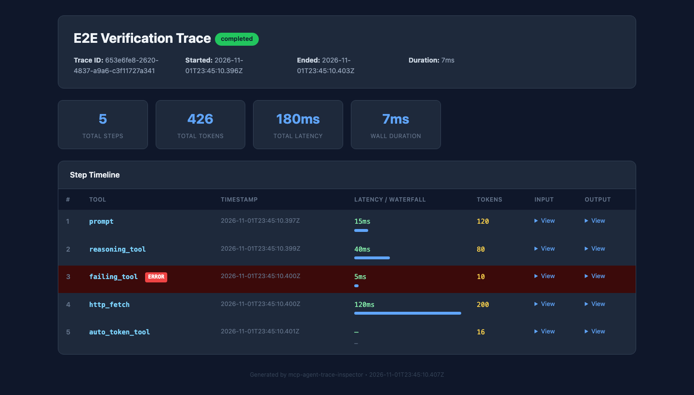
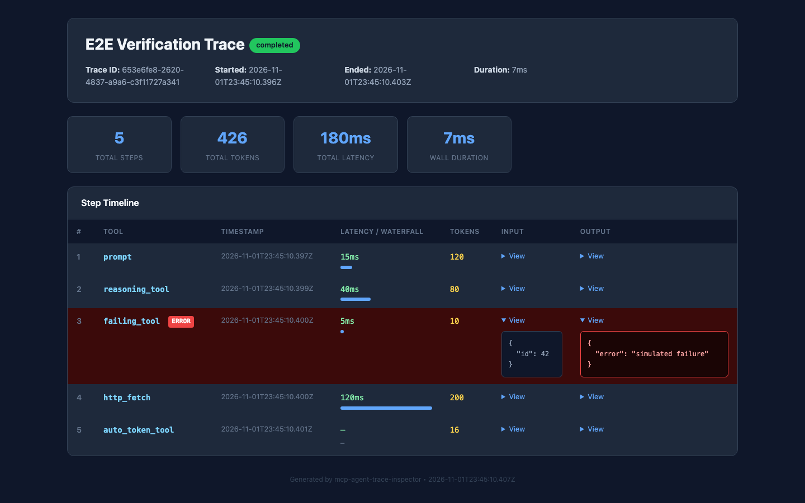
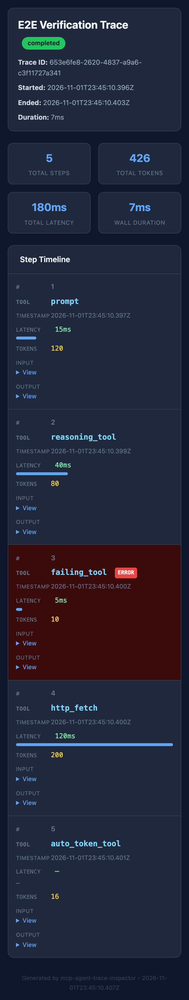

# Verification Report — MCP Agent Trace Inspector

**Final status: PASS (core application)** — all repository-level quality gates pass, the
real stdio and HTTP servers were exercised end to end, and screenshots came from the
running application. Several external/optional integrations remain unverified against live
third-party services; they are listed under [Remaining issues](#remaining-issues-and-limitations).

- **Date:** 2026-11-01 (America/New_York)
- **Repository:** `/Users/newtechlab/Documents/GitHub/mcp-agent-trace-inspector`
- **Branch / commit:** `review` at `0057107ad0de1acff4b15634a67b628b67d22456`
  (working tree contains the fixes described here)
- **Environment:** macOS 27.0.1 (Darwin 27.0.0, arm64), Node v26.13.0, npm 11.20.0.
  Minimum supported Node v22.13.0 was verified separately.
- **Package:** `mcp-agent-trace-inspector@1.0.0`

## Audit scope and methodology

The audit covered the complete repository: `src/`, `tests/`, `dist/`, package and
registry metadata, GitHub Actions workflows, `README.md` and supporting docs, `.env.example`,
`smithery.yaml`, and `server.json`.

Methods:

1. Static review of every source module, test file, workflow, and configuration file.
2. Baseline install, lint, build, audit, test, and formatting runs.
3. Direct MCP protocol calls over stdio using the official SDK client and the MCP Inspector.
4. Real Streamable HTTP requests against the built server, including sequential requests,
   authentication, rate limiting, parse failures, and oversized bodies.
5. Real SQLite persistence and data inspection.
6. Browser rendering through Chrome DevTools Protocol at desktop and mobile viewports,
   with console-error capture.
7. Package tarball creation/install and execution of the packaged binary.
8. Minimum-supported Node version build/test run (v22.13.0).

No mock transport is used by the E2E harness. The only mocked network path is the
unit-level alerting test; a separate E2E check exercises a real local HTTP webhook.

## Architecture and initial assessment

`mcp-agent-trace-inspector` is a TypeScript/ESM MCP server. Its entry point
`dist/index.js` opens SQLite via `node:sqlite` and selects one of two transports:

- **stdio** (default): `createServer({ db, ... })` registers 13 tools, resources, and one
  prompt.
- **stateless Streamable HTTP** (`--http-port`): Express 5 + the MCP SDK HTTP transport,
  optional API-key/JWT auth, rate limiting, and DNS-rebinding protection.

Data flows into `traces` and `steps`, with optional audit JSONL, alert rules, retention
metadata, and generated exports (HTML, OTLP/JSON, compliance JSON/CSV).

The initial code built and linted cleanly, but several advertised features were not wired
to the running paths, and the HTTP transport failed after its first request.

## Initial issues discovered

### Critical / high severity

| ID | Issue | Evidence |
| -- | ----- | -------- |
| P0-1 | HTTP transport returned an HTML 500 for every request after the first (`Already connected to a transport`). | `test-results/baseline-http-multi-request.log` |
| P0-2 | `configure_alerts` persisted rules, but no code ever evaluated them. Alerts never fired. | Code review; baseline runtime probe |
| P0-3 | `--pricing-table` was loaded and discarded; custom models always reported `N/A`. | `test-results/baseline-runtime-probe.log` |
| P1-1 | Server advertised version `0.2.0` while the package was `1.0.0`. | `src/server.ts`, MCP `initialize` response |
| P1-2 | `export_otel` emitted a custom `{traceId, spans}` shape, not OTLP/JSON. | Code review |
| P1-3 | HTTP error paths returned Express HTML and stack traces. | Baseline curl |
| P1-4 | `trace_step` accepted steps after `trace_end`, negative/fractional token counts, and negative latency. | `test-results/baseline-runtime-probe.log` |
| P1-5 | Audit log path was hard-coded to `~/.mcp/...`; a write failure failed the entire `trace_step` call. | Baseline test failures; probe |
| P1-6 | Pre-release workflow used Node 20, which has no `node:sqlite`; `engines` claimed Node 22.5 while the module is gated until 22.13. | Workflow and package review |

### Medium / low severity

| ID | Issue | Impact |
| -- | ----- | ------ |
| P2-1 | `list_traces` accepted a fractional limit and surfaced SQLite `datatype mismatch` as an internal error. | Poor validation/error contract |
| P2-2 | `export_compliance_log` silently returned JSON for any unknown format. | Silent contract violation |
| P2-3 | Date-only `to_date` filters stopped at midnight, excluding later entries that day. | Incorrect compliance exports |
| P2-4 | `js-tiktoken` took 185–248 ms for a 2 KB whitespace-free payload and 31.9 ms for 17.6 KB JSON. | Event-loop stalls; contradicted performance claims |
| P2-5 | Dashboard table required horizontal scrolling on mobile and clipped critical columns. | Responsive-rendering defect |
| P2-6 | Tests wrote to the real home directory; 3 tests failed in the sandbox and without a writable HOME. | Non-hermetic test suite |
| P2-7 | Prettier check failed on 2 files; CI did not run formatting. | Style gate missing |
| P2-8 | JWT verification ignored the header `alg` and `nbf`; rate-limit keying trusted an unvalidated header. | Security hardening gaps |
| P2-9 | `server.json` required a placeholder `YOUR_API_KEY` that the stdio server does not use. | Misleading registry metadata |
| P3-1 | README omitted HTTP/auth/alerts/retention/OTLP details and contained inaccurate performance/tool claims. | Documentation drift |

### Baseline results

- `npm ci` (with an isolated cache; see [Environment note](#environment-note)): pass.
- `npm run lint`: pass.
- `npm run build`: pass.
- `npm audit --audit-level=high`: 0 vulnerabilities.
- `npm test`: **189/192 passed, 3 failed** in the sandbox because tests attempted to write
  under the read-only home directory (`baseline-test.log`). With a writable HOME, all 192
  passed.
- `prettier --check`: **failed** on `src/db.ts` and `tests/retention.test.ts`
  (`baseline-format.log`).
- HTTP: first `initialize` returned 200; second returned an HTML 500 with
  `Already connected to a transport` (`baseline-http-multi-request.log`).
- Runtime probe: custom model cost `N/A`; audit path ignored; alerts absent from
  `trace_end`; `limit: 1.5` produced `datatype mismatch`; steps accepted after completion
  (`baseline-runtime-probe.log`).

## Fixes implemented

### P0-1 — Stateless HTTP request handling

`src/http-server.ts` was rewritten to create a fresh MCP `Server` and
`StreamableHTTPServerTransport` for each `POST /mcp`, closing both when the response
closes. The shared SQLite database, pricing table, audit log, alert channels, and retention
policy remain process-level. Added explicit JSON-RPC errors for parse failures (400),
oversized bodies (413), unknown routes (404), and unsupported GET/DELETE (405 with
`Allow: POST`). Authentication and rate limiting now run before body parsing.

Verified by `tests/http-server.test.ts` (7 tests) and the E2E "two sequential initialize
requests" check.

### P0-2 — Alerts actually evaluated

`src/server.ts` now loads persisted rules and calls `checkAndAlert` on the first
`trace_end` transition. Fired alerts are returned in `trace_end` (`alerts_fired`,
`alerts`) and delivered to Slack/generic webhooks. Repeated `trace_end` calls are
idempotent and do not re-fire. Rule inputs are validated (type, finite non-negative
threshold, http/https webhook URL). Webhooks time out after 5 seconds; delivery failures
are logged without failing the trace tool.

Verified by unit tests, a real local HTTP webhook E2E check, and the Slack payload unit
test.

### P0-3 — Custom pricing wired end to end

`src/index.ts` loads `--pricing-table` into an active `PricingTable` and passes it to
`createServer`. `get_trace_summary` and audit cost estimation use it. Custom entries merge
over built-in rates, so adding a model does not disable Claude cost estimates.

Verified by `tests/inspect-enhanced.test.ts`, `tests/index.test.ts`, and the E2E summary
using a `demo-model` rate.

### P1-1 — Version consistency

Added `src/version.ts`, which reads the nearest `package.json` from both `src/` (tsx,
Vitest) and `dist/`. The MCP `serverInfo` and `--version` now report `1.0.0`.

Verified by `tests/version.test.ts`, server integration initialization, E2E, and
`node dist/index.js --version`.

### P1-2 — Standard OTLP/JSON export

`export_otel` now emits `resourceSpans → scopeSpans → spans` with resource attributes,
scoped spans, typed attribute values, parent span IDs, and OTLP status codes
(unset/OK/error). Non-UUID IDs are hashed into valid lowercase 32/16-character hex IDs.
Running traces use status `0` (unset) rather than error.

Verified structurally by `tests/otel-exporter.test.ts` and the E2E document check. A live
collector ingestion was **not** tested.

### P1-3 — Trace lifecycle and argument validation

- Steps are rejected after `trace_end`.
- `trace_end` is idempotent and does not move `ended_at`.
- `token_count` must be a non-negative integer.
- `latency_ms` must be finite and non-negative.
- `input`/`output` must be objects (not arrays or null).
- `list_traces` limit must be a positive integer.
- Alert rules, webhook schemes, compliance formats/dates, retention days, and model names
  are validated.
- `trace_start` rejects non-string names.

Verified by `tests/trace.test.ts`, `tests/inspect-enhanced.test.ts`, and server integration
tests.

### P1-4 — Audit log robustness and configurability

`MCP_AUDIT_LOG_PATH` is supported; the log is created with mode `0600`; audit write
failures are warned once and no longer fail `trace_step`. The audit log records the
effective token count (including automatically computed counts), and date-only upper
bounds include the entire day. The CSV/JSON exports retain date filtering and now reject
invalid formats/dates.

Verified by audit-log unit tests, server integration, and E2E (7 entries, JSON and CSV).

### P1-5 — Node/CI/runtime compatibility

- `engines.node` is now `>=22.13.0`, the first Node release where `node:sqlite` is
  unflagged.
- The pre-release workflow uses Node 22 and `npm ci`.
- CI now runs Prettier, lint, coverage, build, and the real-process E2E harness.
- All install workflows use `npm ci`.

Verified locally on Node v22.13.0 (build and all 231 tests pass) and Node v26.13.0.

### P2 — Performance, responsive UI, and hermetic tests

- Replaced `js-tiktoken` with `gpt-tokenizer` (`cl100k_base`). With identical token
  counts, 2 KB pathological inputs measured 185.87–247.55 ms in `js-tiktoken` versus
  2.50–3.33 ms in `gpt-tokenizer`; 17.6 KB JSON measured 31.87 ms versus 0.52 ms.
  Evidence: `test-results/tokenizer-benchmark.log`.
- Automatic tokenization above 128 KiB uses a bounded chars/4 estimate; callers can pass
  an exact `token_count`.
- Dashboard now uses card-style step rows below 640 px instead of a clipped 7-column
  table; stat cards reflow; labels/screen-reader text added.
- Tests use temporary audit logs and an in-memory/temp DB; no test writes to HOME.
  `vitest.config.ts` no longer relies on `__dirname`.

### P2 — Security hardening

- JWT verification requires `alg: HS256`, validates `exp`/`nbf`, rejects malformed
  claims, and uses timing-safe comparisons.
- API-key comparison is timing-safe.
- Rate limiting only trusts an API key matching `MCP_API_KEY`; other headers fall back to
  the client IP, preventing header-rotation bypasses. Idle buckets are pruned.
- HTTP binds to `127.0.0.1` by default; loopback mode applies Host-header validation;
  non-loopback binds warn; body limit is 10 MB.
- Removed the bogus required `YOUR_API_KEY` from `server.json` and documented optional
  auth variables.

### P3 — Documentation and evidence

Rewrote `README.md` to match verified behavior, added the verification report and
screenshots, updated `CHANGELOG.md`, `ROADMAP.md`, `CONTRIBUTING.md`, `SECURITY.md`, and
`.env.example`, and added reproducible E2E/screenshot scripts.

## Verification results

### Quality gates

| Check | Command | Result | Evidence |
| ----- | ------- | ------ | -------- |
| Install | `npm ci --cache /tmp/npm-cache` | **PASS** | `build-results/npm-ci.log` |
| Dependency audit | `npm audit --audit-level=high` | **PASS** (0 vulnerabilities) | `build-results/npm-audit.log` |
| Lint | `npm run lint` | **PASS** | `build-results/lint.log` |
| Formatting | `npx prettier --check src tests vitest.config.ts` | **PASS** | `build-results/format-check.log` |
| Type check | `npm run typecheck` | **PASS** | `build-results/typecheck.log` |
| Production build | `npm run build` | **PASS** | `build-results/build.log` |
| Unit/integration tests | `npm test -- --coverage` | **PASS — 231/231, 20 files** | `test-results/vitest.log` |
| Coverage | V8 | **91.33% statements / 86.02% branches / 93.70% functions / 92.08% lines** | `test-results/vitest.log` |
| End-to-end (real processes) | `npm run verify:e2e` | **PASS — 19/19 checks** | `test-results/e2e-summary.json` |
| Minimum Node build/test | Node v22.13.0 + `npm run build && npm test` | **PASS — 231/231** | `test-results/node-22.13.log` |
| Tokenizer benchmark | `js-tiktoken` vs `gpt-tokenizer`, identical inputs | **PASS — identical counts; 2.5–3.3 ms vs 185–248 ms (2 KB)** | `test-results/tokenizer-benchmark.log` |
| MCP Inspector | `tools/list`, `tools/call list_traces` | **PASS** | `test-results/inspector-tools.log`, `inspector-call.log` |
| Browser screenshots | `npm run screenshots` | **PASS — 3 images, 0 console errors** | `screenshots/screenshots.json` |
| Package tarball install | `npm pack` + install + run | **PASS** | `test-results/package-install.log` |

### End-to-end workflows verified

Real stdio server, temp SQLite database, 13 tools:

- `trace_start` → five `trace_step` calls (including an error step and an automatically
  counted step) → summary with status, steps, tokens, latency, duration, cost, and
  reasoning detection.
- `trace_end` raised the expected two alerts (error rate and latency) and a second end was
  idempotent.
- A real local HTTP webhook received a fired alert payload (`alert_type`, threshold,
  value, message, timestamp).
- `export_dashboard` produced completed-state HTML with an error badge, waterfall bars,
  expandable JSON, and no script tags.
- A second trace enabled `compare_traces` (step-diff -3), `list_traces`, and
  `extract_reasoning_chain` (2 of 5 steps).
- Resource `trace://{id}` and prompt `analyze-trace` returned the expected data.
- `export_otel` returned a standard document with six spans.
- `export_compliance_log` returned 7 JSON entries and 7 CSV rows plus header.
- `set_retention_policy` + `apply_retention` completed with zero archives/deletions on
  fresh data.
- Invalid operations (post-end step, fractional limit, unknown format) failed cleanly.

Streamable HTTP:

- Two sequential `initialize` requests both returned 200 and the correct server version.
- `trace_start`/`trace_step`/`trace_end`/`get_trace_summary`/`list_traces` shared one
  database across independent POSTs.
- GET returned 405 with `Allow: POST`; malformed JSON returned 400 JSON-RPC `-32700` with
  no stack trace.
- `MCP_API_KEY` rejected missing/incorrect keys with 401 and accepted the correct key.
- Automated tests additionally cover 429 with `Retry-After` and 413 body limits.

### Screenshots

All screenshots are real Chrome renderings of
`docs/evidence/build-results/dashboard-demo.html`, generated by the actual
`export_dashboard` tool from the E2E trace. Chrome console errors: **0**.

| Screenshot | Demonstrates |
| ---------- | ------------ |
|  | Completed trace, stat cards, five-step timeline, error highlighting, token/latency columns, waterfall bars. |
|  | Failing step's input/output JSON expanded, red error row, `ERROR` badge, and escaped JSON rendering. |
|  | 390×844 mobile layout with reflowed stat cards and card-style step rows instead of a clipped table. |

The source HTML SHA-256, viewport sizes, image dimensions, byte sizes, Chrome path, and
console-error list are recorded in
[`screenshots/screenshots.json`](screenshots/screenshots.json).

### Browser and network observations

- The dashboard is a self-contained HTML file with no `<script src>` and no external
  assets. Chrome loaded it from `file://` and emitted no console errors.
- There are therefore no failed network requests in the rendered dashboard.
- MCP protocol/network behavior was verified separately against the real HTTP server with
  local `fetch` requests; response statuses and JSON-RPC errors are recorded in
  `test-results/http-e2e.json` and `test-results/http-auth-e2e.json`.

## Environment note

The sandbox's default npm cache (`/Users/newtechlab/.npm`) is not writable, so a plain
`npm ci` failed before touching project code. The failure is preserved as
`build-results/npm-ci-default-cache-failure.log`. Installing with an isolated writable
cache (`npm ci --cache /tmp/npm-cache`) succeeded and was used for all subsequent checks.
This is an environment restriction, not a repository defect; GitHub Actions uses a clean
runner cache and plain `npm ci`.

## Remaining issues and limitations

These are explicit limitations, not hidden failures:

1. **Live Slack delivery not exercised.** The Slack block payload is unit-tested and the
   same HTTP POST path delivered a real local generic webhook. No Slack workspace or
   incoming-webhook credential was available. External Slack delivery is therefore
   **unverified**.
2. **OTLP collector ingestion not exercised.** The export is a structurally validated
   OTLP/JSON document; it was not submitted to Jaeger, Grafana Tempo, or an OpenTelemetry
   Collector.
3. **HTTP is stateless by design.** No `Mcp-Session-Id`, resumability, server-initiated SSE
   stream, or OAuth 2.0. GET/DELETE return 405.
4. **Alerts are database-wide and evaluated only on `trace_end`.** No deduplication,
   retry, alert history, or persistence of channel URLs. Webhook delivery is best effort
   with a 5-second timeout.
5. **Token/cost figures are estimates.** Automatic counting uses `cl100k_base` up to
   128 KiB and chars/4 above that. Cost uses one aggregate token count at the input rate;
   it is not provider billing data.
6. **Retention tool policy is in-memory.** `set_retention_policy` must be called again
   after a restart; archived traces remain queryable until deleted.
7. **Single-node SQLite.** No distributed or multi-writer coordination beyond SQLite WAL.
8. **Audit log is append-only by convention, not cryptographically tamper-evident.**
9. **Reverse proxies must rewrite `Host` to `127.0.0.1:<port>`** when the server is bound
   to loopback and DNS-rebinding protection is active.
10. **No hosted dashboard or team-sharing UI.** Dashboards are generated files.
11. **Node support starts at 22.13.0.** `node:sqlite` remains experimental/RC in that
    line and emits an ExperimentalWarning.
12. **Platform coverage.** Verification ran on macOS arm64. Windows and Linux runtime
    behavior were not executed locally (CI is configured for Ubuntu; not run in this
    session).
13. **GitHub Actions were not executed remotely.** Workflows were reviewed and their
    local equivalent commands pass, but no remote CI run is claimed.
14. **Tracked `dist/`.** The compiled output is committed for packaging; source changes
    require `npm run build` before publishing.
15. **Live registry/marketplace listings** (MCP Registry/Market) were not revalidated.

## Reproduction

From a clean checkout:

```bash
npm ci
npm run verify                 # lint + format + typecheck + tests
npm test -- --coverage         # 231 tests + V8 coverage
npm run build
npm run verify:e2e             # real stdio + HTTP + auth + webhook checks
npm run screenshots            # requires Chrome/Chromium; writes docs/evidence/screenshots
```

Expected results: 231 tests pass, coverage above 91% statements/92% lines, build succeeds,
E2E reports 19/19 checks, and three screenshots are produced with `console_errors: []`.

## Final verdict

**PASS — core application.**

The application now starts reliably on both transports, records and inspects real traces,
evaluates alerts, exports HTML/OTLP/compliance data, authenticates and rate-limits HTTP,
and passes its full unit/integration/E2E gates on both the current runtime and the minimum
supported Node version. The limitations above are documented and do not block the core
tracing workflows. Live Slack delivery, real OTLP collector ingestion, remote CI, and
non-macOS runtime verification remain outside the evidence collected here.
